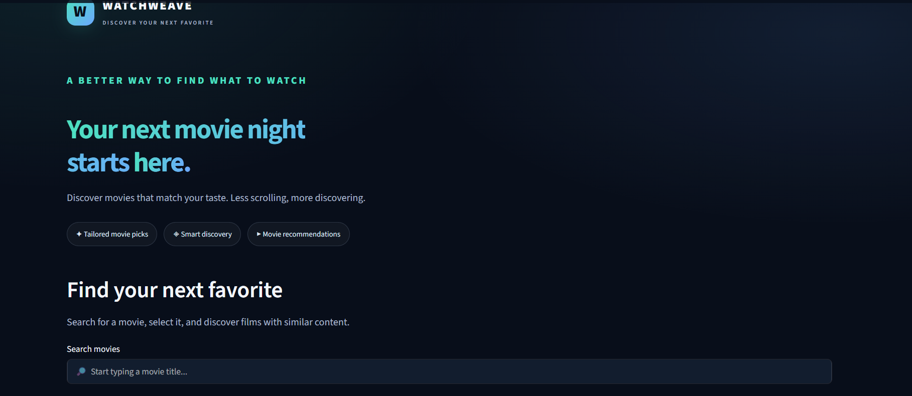
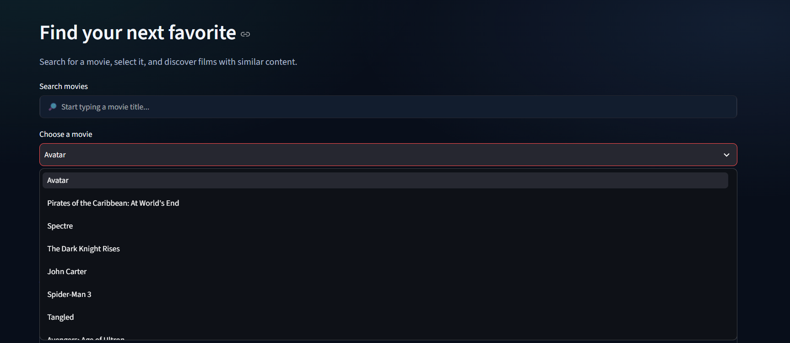
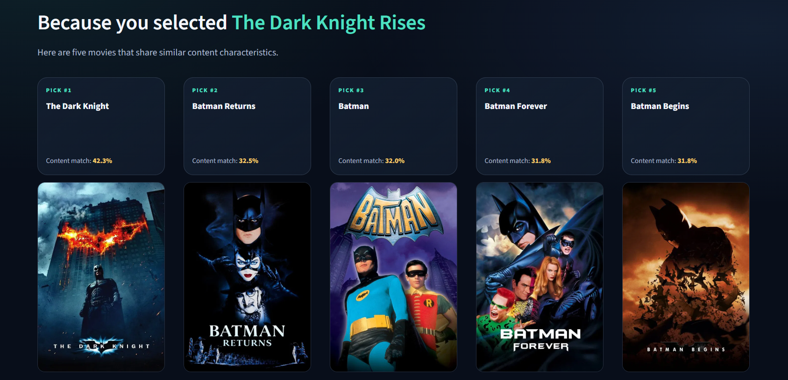
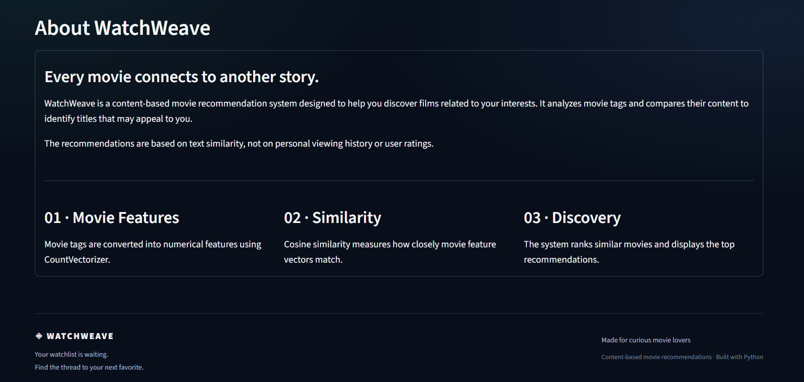

# 🎬 WatchWeave — Movie Recommendation System

Discover your next favorite movie with **WatchWeave**, a content-based movie recommendation system built using Python and Streamlit.

WatchWeave analyzes movie tags and recommends films with similar content characteristics. Its interactive interface allows users to search for movies, explore recommendations, view movie posters, and open movie details on TMDB.

## ✨ Features

- **🔎 Movie Search:** Search and select movies from the available dataset.
- **🎯 Personalized Discovery Experience:** Find movies similar to a selected title.
- **🧠 Content-Based Recommendations:** Use CountVectorizer and cosine similarity to compare movie content.
- **🖼️ Movie Posters:** Retrieve movie posters using The Movie Database (TMDB) API.
- **📊 Similarity Scores:** View the content similarity score for each recommendation.
- **🔗 TMDB Movie Links:** Click a movie poster to explore its details on TMDB.
- **🎨 Modern User Interface:** Enjoy a dark-themed interface with custom styling, hover effects, and responsive layouts.
- **⚡ On-Demand Similarity Calculation:** Calculate similarity for the selected movie without storing a large precomputed similarity matrix.

## 🛠️ Technologies Used

| Technology | Purpose |
|---|---|
| Python | Core programming language |
| Streamlit | Interactive web application |
| Pandas | Movie data handling and processing |
| Scikit-learn | Text vectorization and similarity calculations |
| CountVectorizer | Convert movie tags into numerical features |
| Cosine Similarity | Measure similarity between movie feature vectors |
| TMDB API | Retrieve movie posters and related movie information |
| Git and GitHub | Version control and project hosting |

## ⚙️ How It Works

1. **Load Movie Data:** Load movie titles, IDs, and tags from the dataset.
2. **Feature Extraction:** Use CountVectorizer to transform movie tags into numerical feature vectors.
3. **Select a Movie:** Search for and select a movie in the application.
4. **Calculate Similarity:** Compare the selected movie's feature vector with other movie vectors using cosine similarity.
5. **Rank Recommendations:** Rank movies by similarity and select the top five recommendations.
6. **Explore Movies:** View the recommended titles, similarity scores, and available posters. Open a poster to visit its TMDB movie page.

The system uses movie content rather than personal viewing history or user ratings.

## 📂 Project Structure

```text
watchweave-movie-recommender/
│
└── .streamlit/
│   └── secrets.toml        # Local API key configuration (not committed)
│
└── .screenshots/
    ├── watchweave-about.png
    ├── watchweave-home.png
    ├── watchweave-movie-list.png
    └── watchweave-Suggestions.png
│
├── app.py                 # Streamlit application
├── movie_dict.pkl         # Movie dataset
├── requirements.txt       # Python dependencies
├── README.md              # Project documentation
├── .gitignore             # Files excluded from Git
└── setup.sh               # Setup script
```


## 🚀 Installation and Setup

### 1. Clone the repository

```bash
git clone https://github.com/prakash-kampasati/watchweave-movie-recommender.git
```

### 2. Navigate to the project folder

```bash
cd watchweave-movie-recommender
```

### 3. Create a virtual environment (recommended)

```bash
python -m venv .venv
```

Activate it on Windows:

```bash
.venv\Scripts\activate
```

### 4. Install dependencies

```bash
pip install -r requirements.txt
```

### 5. Configure the TMDB API key (optional)

To display movie posters, obtain an API key from [The Movie Database](https://www.themoviedb.org/).

Create a `.streamlit` folder in the project root, then create `secrets.toml` inside it:

```toml
TMDB_API_KEY = "YOUR_TMDB_API_KEY"
```

Replace the placeholder with your own API key.

**Security:** Never commit your API key or `secrets.toml` to GitHub.

Without an API key, the recommendation functionality can still work, but movie posters may not be displayed.

### 6. Run the application

```bash
streamlit run app.py
```

Streamlit will provide a local URL where you can open WatchWeave in your browser.

## 🖥️ Application Preview

### 🏠 Home Page


### 🎬 Movie List


### 🎯 Movie Suggestions


### ℹ️ About WatchWeave


## 📌 Project Information

**Project Name:** WatchWeave — Movie Recommendation System

**Project Type:** Machine Learning / Recommendation System

**Recommendation Approach:** Content-Based Filtering

**Primary Goal:** Help users discover movies based on similarities in movie content.

## 🔮 Future Improvements

- Add genre-based filtering.
- Display additional movie details, such as release year and overview.
- Improve recommendation quality using additional movie features.
- Add a watchlist and favorite movies feature.
- Explore collaborative filtering and hybrid recommendation approaches.

## 🙏 Acknowledgements

Movie poster images and related movie information are retrieved through The Movie Database (TMDB) API.

This product uses the TMDB API but is not endorsed or certified by TMDB.

Learn more at [The Movie Database](https://www.themoviedb.org/).

---

**Built with Python, Machine Learning, and Streamlit.**